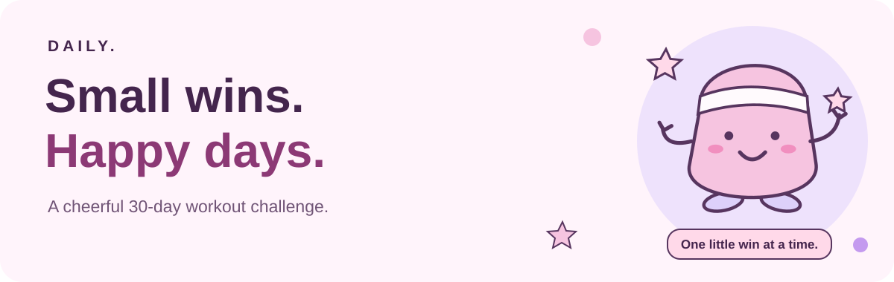
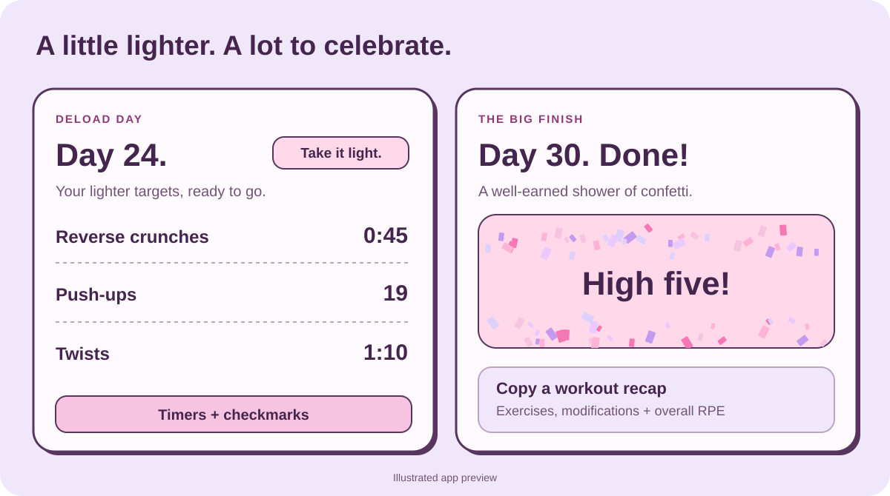

# Daily

A cheerful, phone-friendly 30-day workout challenge. Open today's workout, start a timer, and collect a few small wins.



## What it does

- Daily targets and countdown timers with a completion popup and chime.
- Lighter deload days, rest days, and encouragement as the challenge ramps up.
- Checkmarks and a 30-day progress grid that highlights only completed days.
- Calendar reminders at **7:30 PM America/Denver**, linking to each day's workout at [workouts.nicholaslong.org](https://workouts.nicholaslong.org/).
- A copyable workout recap with modifications and overall RPE.
- A big confetti celebration when you finish day 30.



Progress and workout check-ins are saved in the browser you use. Keep the page open for timer alerts; phone sleep can delay them. Optional browser alerts can be enabled under **Timer sound & alerts**.

## Run or update

Plain HTML, CSS, and JavaScript. No build step.

Open `index.html`, or preview locally:

```sh
python3 -m http.server 8080
```

Edit [challenge.js](challenge.js) for the next challenge, then redeploy through GitHub Pages. Cloudflare handles public HTTPS; keep its DNS record **Proxied**.
